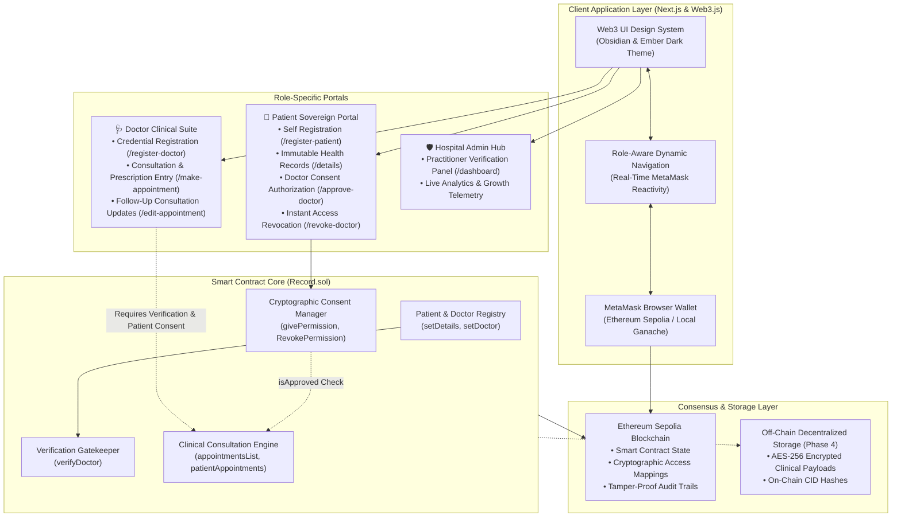
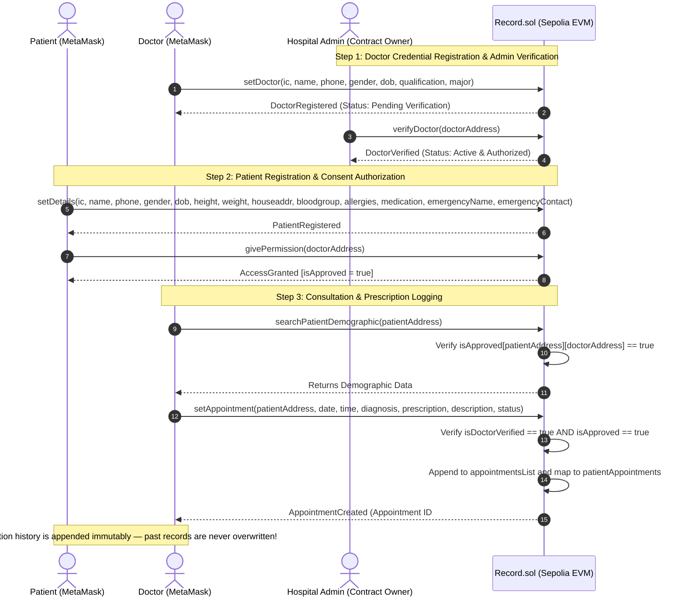

# MediBlock — Decentralized Healthcare & Medical Records System

[](https://soliditylang.org/)
[](https://sepolia.etherscan.io/address/0xB1Af58d43fDf8e5a637BcdeBB52DfE1E32AF0f2D)
[](https://sepolia.etherscan.io/address/0xB1Af58d43fDf8e5a637BcdeBB52DfE1E32AF0f2D)
[](https://nextjs.org/)
[](https://web3js.readthedocs.io/)
[](https://mochajs.org/)
[](https://opensource.org/licenses/ISC)

> **MediBlock** is a patient-sovereign, decentralized electronic health records (EHR) and hospital management platform built on **Ethereum**. By enforcing cryptographic consent, immutable clinical consultation history, role-based access control, and hospital-verified practitioner credentials, MediBlock eliminates single points of failure in centralized healthcare databases while keeping patients in full control of their medical records.

---

## 🌐 Live Smart Contract (Sepolia Testnet)

| Parameter | Value |
|---|---|
| **Network** | Ethereum Sepolia Testnet |
| **Contract Address** | [`0xB1Af58d43fDf8e5a637BcdeBB52DfE1E32AF0f2D`](https://sepolia.etherscan.io/address/0xB1Af58d43fDf8e5a637BcdeBB52DfE1E32AF0f2D) |
| **Contract Deployer (Admin)** | [`0xd6aa237Efb610C2c4eF7a27878a8b79f874226E9`](https://sepolia.etherscan.io/address/0xd6aa237Efb610C2c4eF7a27878a8b79f874226E9) |
| **Explorer** | [View on Sepolia Etherscan](https://sepolia.etherscan.io/address/0xB1Af58d43fDf8e5a637BcdeBB52DfE1E32AF0f2D) |

---

## 1. System Architecture

### High-Level Architecture Diagram



---

### Consent & Clinical Consultation Sequence



---

## 2. Key Features

- **🔐 Cryptographic Patient Consent:** Doctors cannot read patient medical histories or write consultations without explicit, signed patient approval (`givePermission`). Consent can be revoked instantly at any time (`RevokePermission`).
- **🩺 Hospital Admin Doctor Verification:** Prevents rogue actors from posing as physicians. Registered doctors must be approved by the hospital contract owner before they can issue medical consultations.
- **📜 Multi-Consultation Append-Only History:** Fixes legacy contract bugs by indexing all consultations in an array (`appointmentsList`). Patient visits and prescription logs are preserved immutably over time.
- **🧭 Dynamic Role-Aware Navigation:** The frontend header dynamically queries `isPatient`, `isDoctor`, and `owner()`. Patients only see patient tools, doctors only see clinical workflows, and new users see registration prompts.
- **🎨 Obsidian & Ember Web3 UI:** Built with a high-contrast dark aesthetic, glassmorphic containers, ember radial gradients, and interactive workflow simulators.
- **📊 Real-Time Analytics Dashboard:** Visualizes hospital growth metrics (patient-to-doctor ratios, monthly onboarding charts) using Recharts with built-in zero-division safety.

---

## 3. Dynamic Role-Aware Navigation Matrix

| User Role | Visible Navigation Items | Wallet Pill Status Badge |
|---|---|---|
| **👤 Patient** | `Home`, `Dashboard`, `Directory`, `My Health Record`, `Consent & Permissions` (Grant/Revoke), `Edit Details` | `[Patient Name] 0x... 👤 PATIENT` |
| **🩺 Doctor** | `Home`, `Dashboard`, `Directory`, `Doctor Profile`, `Consultations` (New Consult, Update Consult, Edit Profile) | `[Doctor Name] 0x... 🩺 DOCTOR ✓` |
| **🛡️ Admin / Owner** | Full system visibility + Exclusive **Doctor Verification Panel** on `/dashboard` | `0x... 🛡️ ADMIN` |
| **🆕 Unregistered User** | `Home`, `Dashboard`, `Directory`, `Register` dropdown (Register as Patient / Doctor) | `0x... NEW USER` |
| **⚠️ Wrong Network** | Automatic detection when the smart contract is not deployed on the current network | `0x... ⚠️ CONTRACT NOT ON NETWORK` |

---

## 4. Web3 Design System Tokens

| Design Token | CSS Variable | Hex / RGBA Value | Role / Usage |
|---|---|---|---|
| **Deep Canvas** | `--bg-canvas` | `#090A0E` | Dark obsidian baseline background |
| **Surface** | `--bg-surface` | `#12141B` | Raised panel and table container background |
| **Glass Surface** | `--bg-surface-glass` | `rgba(18, 20, 27, 0.85)` | Glassmorphic cards with backdrop blur |
| **Ember Accent** | `--accent-primary` | `#FF4D2D` | Primary brand accent & action buttons |
| **Ember Hover** | `--accent-hover` | `#FF6647` | Interactive button and link hover state |
| **Radial Glow** | `--accent-glow` | `rgba(255, 77, 45, 0.45)` | Atmospheric hero ambient glow |
| **Success / Verified** | `--status-success` | `#10B981` | Verified practitioner badge & confirmations |
| **Cyan Patient** | `--patient-cyan` | `#38BDF8` | Patient badges and medical record accents |

---

## 5. Project Directory Structure

```text
blockchain-hospital-record/
├── components/
│   ├── Layout.js            # Global layout, Head metadata & embedded dark theme
│   ├── MenuBar.js           # Dynamic role-aware navigation with MetaMask reactivity
│   └── theme.css            # MediBlock Ember-Obsidian CSS variables & design tokens
├── ethereum/
│   ├── build/
│   │   └── Record.json      # Compiled contract ABI & bytecode artifact
│   ├── contracts/
│   │   └── Record.sol       # Solidity 0.4.26 smart contract with consent & verification
│   ├── compile.js           # Smart contract compilation script (solc)
│   ├── deploy.js            # Real-network Sepolia deployment runner (supports Private Key / Mnemonic)
│   ├── deploy-local.js      # Zero-cost local Ganache deployment script
│   ├── record.js            # Web3 Contract instance loader with live fallback
│   └── web3.js              # Web3 provider (MetaMask / Public Sepolia RPC fallback)
├── pages/
│   ├── index.js             # Web3 Landing Page (Hero, Flow Simulator, 3-Tier Cards)
│   ├── dashboard.js         # Hospital Analytics & Admin Doctor Verification Hub
│   ├── list.js              # Consent-gated patient directory & address search
│   ├── details.js           # Patient record profile & consultation history viewer
│   ├── details-doctor.js    # Doctor credentials & specialization viewer
│   ├── register-patient.js  # Patient demographic & medical onboarding
│   ├── register-doctor.js   # Physician credential registration
│   ├── approve-doctor.js    # Patient consent authorization portal
│   ├── revoke-doctor.js     # Patient consent revocation portal
│   ├── make-appointment.js  # Clinical consultation & prescription entry
│   ├── edit-appointment.js  # Clinical notes & prescription update form
│   ├── edit-patient.js      # Patient personal profile editor
│   └── edit-doctor.js       # Doctor professional profile editor
├── test/
│   └── Record.test.js       # Mocha + Ganache automated test suite (8 passing unit tests)
├── .env.example             # Environment variables template
├── package.json             # Scripts & dependencies
├── routes.js                # Next-routes dynamic route definitions
├── server.js                # Custom Node.js HTTP server for Next-routes
├── ROADMAP.md               # Detailed phase execution checklist
└── README.md                # Project documentation & architecture
```

---

## 6. Quickstart Guide

### Prerequisites
- [Node.js](https://nodejs.org/) v18+ or v22+
- [MetaMask](https://metamask.io/) browser extension installed
- Sepolia Testnet ETH (from [Sepolia Faucet](https://sepoliafaucet.com/)) or a local Ganache instance

### 1. Installation

```bash
git clone https://github.com/gensine/blockchain-hospital-record.git
cd blockchain-hospital-record
npm install --legacy-peer-deps
```

### 2. Environment Configuration

Copy the example environment file:
```bash
cp .env.example .env
```

Your `.env` comes pre-configured with a public Sepolia RPC:
```env
RPC_URL=https://ethereum-sepolia-rpc.publicnode.com
NEXT_PUBLIC_RPC_URL=https://ethereum-sepolia-rpc.publicnode.com
NEXT_PUBLIC_CONTRACT_ADDRESS=0xB1Af58d43fDf8e5a637BcdeBB52DfE1E32AF0f2D
```

### 3. Run Automated Unit Tests

Execute the 8 Mocha smart contract test suites:
```bash
npm test
```

Expected output:
```text
  MediBlock Smart Contract Tests
    ✔ can deploy record contract and assign owner as verified (235ms)
    ✔ can register a patient record (746ms)
    ✔ prevents duplicate patient registration (1194ms)
    ✔ can register a doctor and only admin can verify them (1339ms)
    ✔ enforces patient consent and doctor verification for appointment creation (4196ms)
    ✔ stores multiple appointments without overwriting history (4600ms)
    ✔ correctly tracks permissionGrantedCount upon grants and revokes (2390ms)
    ✔ revoked doctor loses access to search patient details (1637ms)

  8 passing (19s)
```

### 4. Start the Application

```bash
npm run dev
```

Open [http://localhost:3000](http://localhost:3000) in your browser with MetaMask switched to **Sepolia**.

---

## 7. Smart Contract Deployment (Optional)

### Option A: Deploy to Sepolia Testnet
To deploy your own instance of `Record.sol` to Sepolia:
1. Export your test account private key from MetaMask (**Account Details &rarr; Show Private Key**).
2. Add it to `.env`:
   ```env
   DEPLOYER_PRIVATE_KEY=your_private_key_here
   ```
3. Run:
   ```bash
   npm run deploy
   ```
   *The script automatically verifies your balance, deploys the contract, prints the Etherscan URL, and updates `NEXT_PUBLIC_CONTRACT_ADDRESS` in `.env`.*

### Option B: Zero-Cost Local Testing (Ganache)
To test locally without spending testnet ETH:
1. Start Ganache CLI:
   ```bash
   npx ganache-cli -p 8545 -d
   ```
2. In a separate terminal, deploy locally:
   ```bash
   npm run deploy:local
   ```
3. Add a custom network in MetaMask (`http://127.0.0.1:8545`, Chain ID: `1337`), import one of Ganache's private keys, and start the app (`npm run dev`).

---

## 8. Smart Contract Reference (`Record.sol`)

### Key State Mappings
- `isPatient(address => bool)`: Verifies if an address has an existing patient record.
- `isDoctor(address => bool)`: Verifies if an address is registered as a physician.
- `isDoctorVerified(address => bool)`: Tracks hospital admin approval status for physicians.
- `isApproved(address patient => mapping(address doctor => bool))`: Cryptographic consent mapping.
- `patientAppointments(address => uint[])`: Array of consultation IDs associated with a patient.

### Primary Functions
| Function | Access Modifier | Description |
|---|---|---|
| `setDetails(...)` | Public (Unregistered) | Registers a new patient record with demographic & baseline clinical info |
| `setDoctor(...)` | Public (Unregistered) | Registers a physician credential (Status: Pending Verification) |
| `verifyDoctor(address)` | Owner / Admin Only | Approves a registered physician, granting appointment creation privileges |
| `givePermission(address)` | Patient Only | Grants a physician permission to access medical history & log consults |
| `RevokePermission(address)` | Patient Only | Revokes physician access immediately |
| `setAppointment(...)` | Verified Doctor Only | Creates a clinical consultation (Diagnosis, Rx, Status) with patient consent |
| `updateAppointment(...)` | Attending Doctor / Owner | Updates an existing consultation note or prescription |
| `searchPatientDemographic(address)` | Authorized / Owner | Retrieves patient demographic information |
| `searchPatientMedical(address)` | Authorized / Owner | Retrieves baseline medical history, allergies, and emergency contact |
| `searchAppointment(address)` | Patient / Doctor / Owner | Retrieves consultation records and prescriptions |

---

## 9. Roadmap

- [x] **Phase 0:** Hygiene, secrets rotation & environment configuration.
- [x] **Phase 1:** Smart contract security, consent enforcement, append-only consultations & admin verification.
- [x] **Phase 2:** Obsidian & Ember Web3 design system, responsive UI & dynamic role-aware navigation.
- [x] **Phase 3:** Automated Mocha test suite (8 tests) & production build verification.
- [ ] **Phase 4 (Planned):** Off-chain decentralized storage via IPFS (Pinata) with AES-256-GCM encryption for lab reports & medical PDFs.
- [ ] **Phase 5 (Planned):** Time-expirable consent grants & HL7 FHIR compliance.

---

## 10. License

This project is licensed under the **ISC License**.
