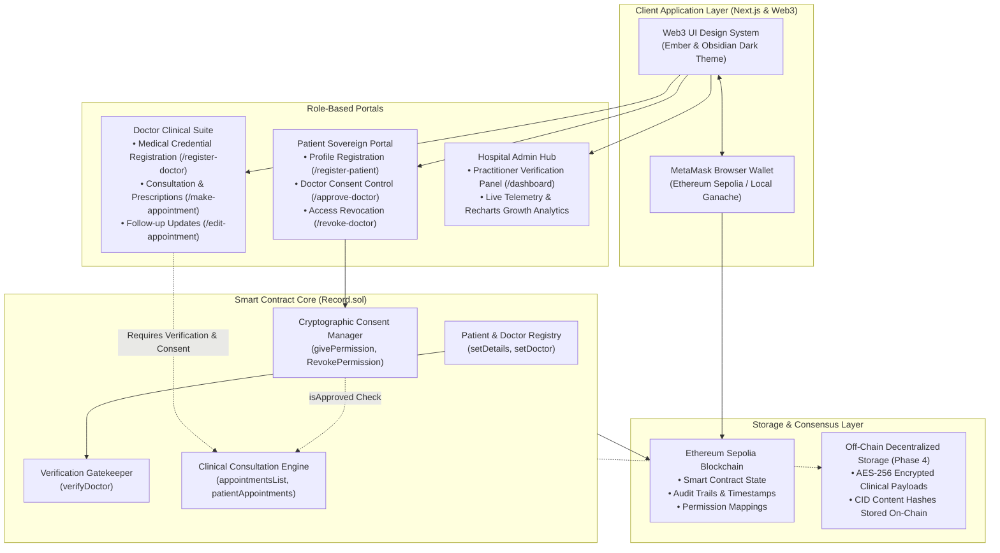
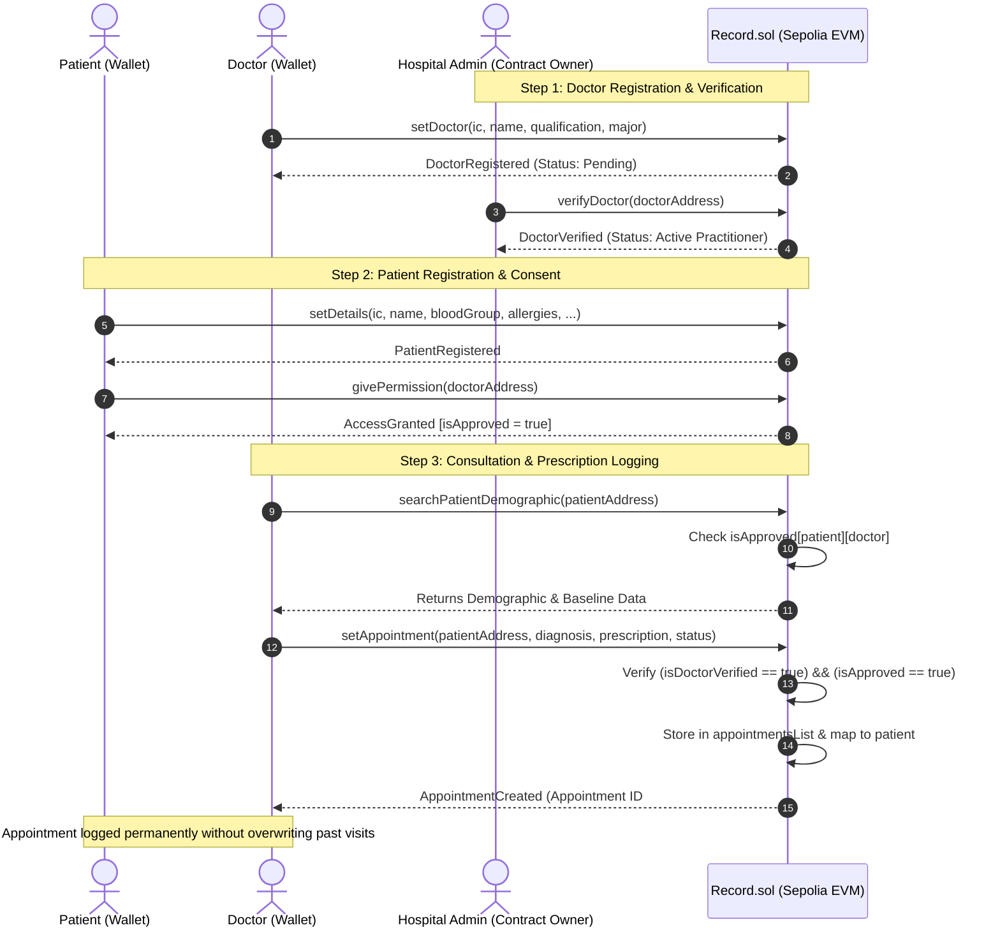

# MediBlock — Decentralized Hospital & Healthcare Records System

[](https://soliditylang.org/)
[](https://sepolia.etherscan.io/)
[](https://nextjs.org/)
[](https://web3js.readthedocs.io/)
[](https://mochajs.org/)
[](https://opensource.org/licenses/ISC)

> **MediBlock** is a patient-sovereign, decentralized medical records and hospital management platform built on **Ethereum**. It eliminates single points of failure in traditional Electronic Health Record (EHR) databases by enforcing cryptographic consent, immutable clinical audit trails, and role-verified practitioner credentials via smart contracts.

---

## 1. System Architecture

### High-Level Architecture Diagram



---

### Consent & Clinical Consultation Sequence Diagram



---

## 2. Process Breakdown & Task Roadmap

### Phase 0: Secrets & Repository Hygiene [COMPLETED]
- [x] **Secret Rotation & Isolation:** Deprecated exposed Infura keys and hardcoded private seed phrases.
- [x] **Environment Variable Management:** Created `.env.example` with template variables for `RPC_URL`, `DEPLOYER_MNEMONIC`, and `NEXT_PUBLIC_CONTRACT_ADDRESS`.
- [x] **Secure Script Config:** Refactored `ethereum/deploy.js` and `ethereum/web3.js` to safely read environment variables using `dotenv`.
- [x] **Dependency Optimization:** Removed unused `electron` devDependency from `package.json`.

---

### Phase 1: Smart Contract Security & Bug Fixes [COMPLETED]
- [x] **Task 1.1: Multi-Appointment Storage:** Refactored `Record.sol` to index appointments via `Appointments[] public appointmentsList` and `mapping(address => uint[]) patientAppointments`. Appointments are never overwritten on follow-up visits.
- [x] **Task 1.2: Strict Consent Enforcement on Writes:** `setAppointment` strictly enforces `require(isApproved[_addr][msg.sender])`. Unapproved doctors cannot write to patient records.
- [x] **Task 1.3: Access-Gated Record Search:** Added cryptographic permission checks to `searchAppointment` so only the patient, the attending physician, or the admin can read sensitive prescriptions and diagnoses.
- [x] **Task 1.4: Admin Doctor Verification System:** Implemented `verifyDoctor(address)` so newly registered doctors require admin approval before issuing clinical appointments.
- [x] **Task 1.5: Permission Counter Accuracy:** Fixed `permissionGrantedCount` to increment only on first grant and properly decrement on revocation.
- [x] **Task 1.6: EVM Input Validation:** Added zero-address validations (`require(_addr != address(0))`) and non-empty string checks.
- [x] **Task 1.7: Comprehensive Event Logging:** Added `PatientRegistered`, `DoctorRegistered`, `DoctorVerified`, `AccessGranted`, `AccessRevoked`, `AppointmentCreated`, and `AppointmentUpdated`.
- [x] **Task 1.8: Consultation Edit Protection:** `updateAppointment` requires the caller to be the doctor who created the record (or contract owner).

---

### Phase 2: Frontend Design System & Role-Based UX [COMPLETED]
- [x] **Task 2.1: Modern Web3 Visual Identity:** Redesigned UI with deep obsidian (`#090A0E`), atmospheric ember sunset radial glow, and fiery orange (`#FF4D2D`) accents matching Web3 inspiration designs.
- [x] **Task 2.2: Redesigned Landing Page (`/`):** Interactive hero architecture simulator (Patient Flow vs. Doctor Flow) and 3-tier comparative role cards.
- [x] **Task 2.3: Real-Time Wallet Status Header (`components/MenuBar.js`):** Sticky glassmorphic navigation with live connected MetaMask wallet pill (`● 0x... (Sepolia)`).
- [x] **Task 2.4: Real Error Messaging:** Replaced generic "account already exists" alerts with specific feedback (user rejected tx, unauthorized access, or validation failures).
- [x] **Task 2.5: No More Alert Popups:** Replaced all browser `alert()` calls with inline status banners and transaction progress loaders.
- [x] **Task 2.6: Dashboard Telemetry & Admin Panel (`/dashboard`):** Grouped registration timelines by month-year, fixed divide-by-zero risks, and added an **Admin Doctor Verification Panel**.
- [x] **Task 2.7: Consent Gateways (`/approve-doctor`, `/revoke-doctor`):** Added directory of registered doctors for one-click access granting, and active grants list with one-click revocation.
- [x] **Task 2.8: Consultation Workflow (`/make-appointment`):** Added authorized patient dropdown to prevent manual copy-paste of hex addresses.
- [x] **Task 2.9: Safe Client Hydration:** Migrated wallet-dependent reads (`web3.eth.getAccounts()`) to `componentDidMount` to eliminate SSR crashes.

---

### Phase 3: Automated Testing & Verification [COMPLETED]
- [x] **Task 3.1: Ganache & Mocha Test Suite:** Expanded `test/Record.test.js` to 8 comprehensive unit tests covering:
  1. Contract deployment & owner assignment.
  2. Patient record creation.
  3. Revert on duplicate patient registration.
  4. Doctor registration & admin verification enforcement.
  5. Consent requirement for appointment creation.
  6. Non-overwriting multiple appointment history.
  7. Accurate grant/revoke counter tracking.
  8. Access denial for revoked doctors.
- [x] **Task 3.2: Production Build Verification:** Verified Next.js 12-page static and dynamic production build with zero errors.

---

### Phase 4: Encrypted Off-Chain Storage (IPFS) [UP NEXT / PLANNED]
- [ ] **Task 4.1: Off-Chain Architecture:** Store only cryptographic hashes and IPFS Content Identifiers (CIDs) on-chain; sensitive data (names, IC, allergies, prescriptions) stored off-chain.
- [ ] **Task 4.2: Client-Side Encryption:** Implement AES-256-GCM record encryption using random symmetric keys wrapped with doctor/patient public keys (ECIES or Lit Protocol).
- [ ] **Task 4.3: Decentralized Pinning:** Integrate Pinata / web3.storage API for decentralized storage.
- [ ] **Task 4.4: File Attachments:** Enable upload of lab reports, blood work PDFs, and medical scans.

---

### Phase 5: Advanced Healthcare & Compliance Features [FUTURE]
- [ ] **Task 5.1: Expirable & Scoped Consent:** Implement access expiration timestamps (e.g. 7-day emergency grant) and scoped categories (Labs Only, Imaging Only).
- [ ] **Task 5.2: Audit Trail Log:** Patient dashboard displaying a chronological timeline of which doctors viewed their record and when.
- [ ] **Task 5.3: Emergency Break-Glass Override:** Emergency QR-code access for first responders with logged on-chain alerts.
- [ ] **Task 5.4: HL7 FHIR Standard Mapping:** Standardize patient records to match international HL7 FHIR and ICD-10 medical terminology.

---

## 3. Web3 Design System Tokens

| Token | Value | Description |
|---|---|---|
| `--bg-canvas` | `#090A0E` | Deep Obsidian Pitch Dark Canvas |
| `--bg-surface` | `#12141B` | Elevated Surface Background |
| `--bg-surface-glass` | `rgba(18, 20, 27, 0.85)` | Glassmorphic Translucent Card Surface |
| `--accent-primary` | `#FF4D2D` | Vibrant Fiery Ember Red-Orange |
| `--accent-hover` | `#FF6647` | Active / Hover Accent State |
| `--accent-glow` | `rgba(255, 77, 45, 0.45)` | Button & Active Card Glowing Aura |
| `--accent-pill-bg` | `rgba(255, 77, 45, 0.08)` | Translucent Announcement Pill Background |
| `--accent-pill-border` | `rgba(255, 77, 45, 0.32)` | Announcement Pill Border Highlight |
| `--border-subtle` | `rgba(255, 255, 255, 0.08)` | Card & Container Hairline Dividers |
| `--status-success` | `#10B981` | Verified Practitioner & Active Status |

---

## 4. Project Directory Structure

```text
blockchain-hospital-record/
├── components/
│   ├── Layout.js            # Global layout, Head metadata & embedded dark theme
│   ├── MenuBar.js           # Responsive navigation header with live MetaMask status
│   └── theme.css            # MediBlock Ember-Obsidian CSS variables & design tokens
├── ethereum/
│   ├── build/
│   │   └── Record.json      # Compiled contract ABI & bytecode artifact
│   ├── contracts/
│   │   └── Record.sol       # Solidity 0.4.26 smart contract with consent & verification
│   ├── compile.js           # Smart contract compilation script
│   ├── deploy.js            # Sepolia testnet deployment script (via Infura)
│   ├── record.js            # Initialized web3 Contract instance
│   └── web3.js              # Web3 provider (MetaMask / Infura HTTP fallback)
├── pages/
│   ├── index.js             # Web3 Landing Page (Hero, Flow Simulator, 3-Tier Cards)
│   ├── dashboard.js         # Hospital Analytics & Admin Doctor Verification Hub
│   ├── list.js              # Consent-gated patient directory & address search
│   ├── details.js           # Patient record profile & consultation history viewer
│   ├── details-doctor.js    # Doctor credentials & specialization viewer
│   ├── register-patient.js  # Patient demographic & medical onboarding
│   ├── register-doctor.js   # Physician credential registration
│   ├── approve-doctor.js    # Patient consent authorization portal
│   ├── revoke-doctor.js     # Patient consent revocation portal
│   ├── make-appointment.js  # Clinical consultation & prescription entry
│   ├── edit-appointment.js  # Clinical notes & prescription update form
│   ├── edit-patient.js      # Patient personal profile editor
│   └── edit-doctor.js       # Doctor professional profile editor
├── test/
│   └── Record.test.js       # Mocha + Ganache automated test suite (8 tests)
├── .env.example             # Environment variables template
├── package.json             # Scripts & dependencies
├── routes.js                # Next-routes dynamic route definitions
├── server.js                # Custom Node.js HTTP server for Next-routes
└── README.md                # Project documentation & architecture
```

---

## 5. Getting Started

### Prerequisites
- [Node.js](https://nodejs.org/) v18+ or v22+
- [MetaMask](https://metamask.io/) browser extension installed
- Sepolia Testnet ETH (from any [Sepolia Faucet](https://sepoliafaucet.com/))

### Installation

1. **Clone the repository:**
   ```bash
   git clone https://github.com/gensine/blockchain-hospital-record.git
   cd blockchain-hospital-record
   ```

2. **Install project dependencies:**
   ```bash
   npm install --legacy-peer-deps
   ```

3. **Configure Environment Variables:**
   Create a `.env` file in the project root:
   ```bash
   cp .env.example .env
   ```
   Fill in your RPC URL and deployer credentials:
   ```env
   RPC_URL=https://sepolia.infura.io/v3/YOUR_INFURA_PROJECT_ID
   NEXT_PUBLIC_RPC_URL=https://sepolia.infura.io/v3/YOUR_INFURA_PROJECT_ID
   DEPLOYER_MNEMONIC="your twelve word seed phrase here"
   NEXT_PUBLIC_CONTRACT_ADDRESS=0x876a8101E934d032EAB97aA800f03159A60b327E
   ```

4. **Compile Smart Contract:**
   ```bash
   npm run compile
   ```

5. **Run the Automated Test Suite:**
   ```bash
   npm test
   ```

6. **Start the Development Server:**
   ```bash
   npm run dev
   ```
   Open [http://localhost:3000](http://localhost:3000) in your browser.

7. **Production Build:**
   ```bash
   npm run build
   ```

---

## 6. Smart Contract Reference (`Record.sol`)

### Key State Mappings
- `isPatient(address => bool)`: Verifies if a wallet address has an active patient record.
- `isDoctor(address => bool)`: Verifies if a wallet address has a doctor profile.
- `isDoctorVerified(address => bool)`: Indicates whether the hospital admin has verified the doctor.
- `isApproved(address patient => mapping(address doctor => bool))`: Cryptographic consent mapping.
- `patientAppointments(address => uint[])`: List of appointment IDs associated with a patient.

### Primary Functions
| Function | Access | Description |
|---|---|---|
| `setDetails(...)` | Public (Unregistered) | Registers a new patient record with demographic & baseline clinical info |
| `setDoctor(...)` | Public (Unregistered) | Registers a new doctor profile (Status: Pending Verification) |
| `verifyDoctor(address)` | Owner / Admin Only | Approves a registered doctor, enabling them to issue appointments |
| `givePermission(address)` | Patient Only | Authorizes a specific doctor to view medical details & create consults |
| `RevokePermission(address)` | Patient Only | Revokes data access from a doctor immediately |
| `setAppointment(...)` | Verified Doctor Only | Creates a consultation entry with diagnosis, prescription, and status |
| `updateAppointment(...)` | Attending Doctor / Owner | Updates an existing consultation note or prescription |
| `searchPatientDemographic(address)` | Authorized / Owner | Retrieves patient demographic information |
| `searchPatientMedical(address)` | Authorized / Owner | Retrieves patient medical history, allergies, and emergency contact |
| `searchAppointment(address)` | Patient / Doctor / Owner | Retrieves latest consultation details and prescriptions |

---

## 7. Security & Threat Model Summary

- **On-Chain Access Boundaries:** Demographic and medical data reads are gated by `require(isApproved[_address][msg.sender])`.
- **Identity Integrity:** Wallet addresses serve as immutable cryptographic public keys; users cannot impersonate other patients or physicians.
- **Consultation Tamper-Resistance:** Clinical records cannot be modified by third parties; only the attending physician who created the entry can post updates.
- **Roadmap to Zero-Knowledge & Confidentiality:** Phase 4 moves patient PII off-chain to encrypted IPFS clusters, ensuring on-chain immutability is paired with strict GDPR / HIPAA compliance and the right to privacy.

---

## 8. License

This project is licensed under the **ISC License**.
